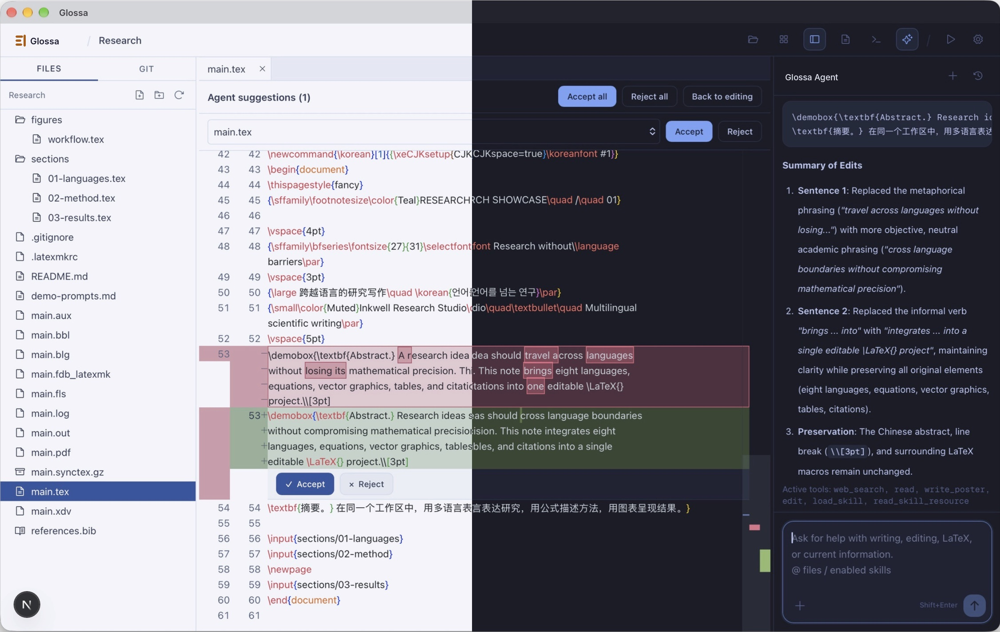
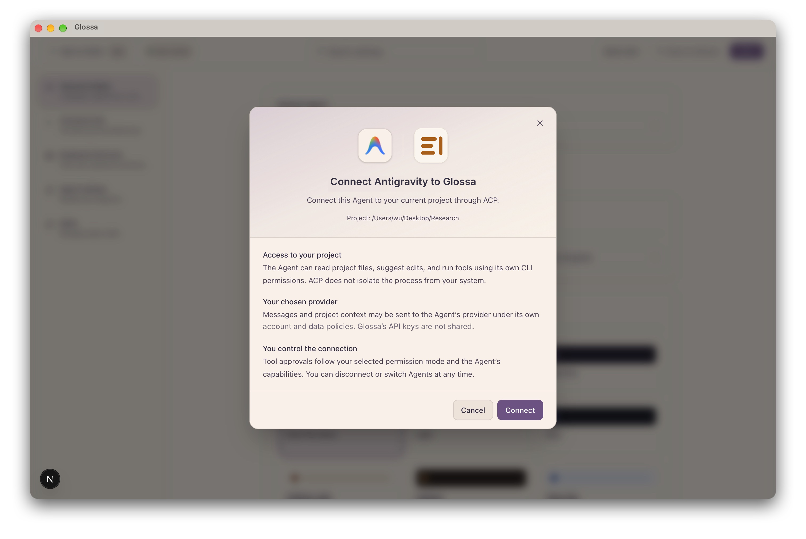

<div align="center">

# Glossa

**A local-first LaTeX workspace for research writing.**

Glossa brings paper editing, PDF preview, Agent collaboration, and Git version control into one desktop app. Keep your workflow connected, from the first draft through reviewing edits, compiling, and syncing your paper.

Your papers stay in ordinary local files. Continue using your existing tools and choose your own model provider or Agent.

[](https://github.com/Weifeng2Wu/glossa/actions/workflows/desktop-build.yml)
[](LICENSE)
[](https://github.com/Weifeng2Wu/glossa)

[Download](https://github.com/Weifeng2Wu/glossa/releases/latest) · [Features](#core-features) · [Quick Start](#quick-start)

**English** | [简体中文](README_zh.md) | [한국어](README_ko.md)

</div>



## Core Features

### Automatic engine selection, less setup

Glossa inspects your project source and installed compilers to select a suitable LaTeX engine. Compiler detection and installation helpers reduce manual setup.

View compilation results, inspect errors, and navigate between PDF and source with SyncTeX in the same workspace. Multilingual documents can use XeLaTeX or LuaLaTeX; required fonts and packages depend on the project.

### Read papers and manage references

PDFs anywhere in your project are identified automatically in the background, without opening the library or importing them first. Glossa looks up their DOI, arXiv ID or title on Crossref and arXiv, shows recognized paper titles in the file tree, and adds references to the project's `.bib` file. Hover for authors, year, venue and the original filename; files are not renamed. You can also import external PDFs or paste a DOI, link, title or BibTeX entry.

Highlight, underline, take Markdown notes and translate selections while reading; insert citations from the library with one click while writing. References, PDFs and notes are plain project files, so they sync with Git.

### Mind maps, drawings and academic posters

Create a mind map (`.mindmap.md`) or an Excalidraw drawing (`.excalidraw`) from the file-tree context menu or command palette, or press `Ctrl/Cmd+Alt+M` and `Ctrl/Cmd+Alt+D`. Both use project files, automatic saving, split panes and Git sync.

Mind maps store one Markdown heading and nested bullet lists, with optional inline metadata for fonts, colors and branch directions. Add left or right branches, style a node and its descendants, hold Space and drag to pan, or fit the whole map. Tab adds a child, Enter adds a sibling and F2 edits its label. Undo/redo and SVG export retain the styles. Drawings use the official Excalidraw format with locally bundled fonts for offline editing. File-tree rows and tabs hide the long mind-map and poster suffixes and use distinct icons; full filenames remain available on hover and when renaming.

All `.poster.json` files open in the freeform canvas, whether created manually or by an Agent. Move and resize text, shapes and figures, adjust the selected element's properties, and export PPTX, SVG, PDF or images. New documents and Agent proposals use version 1. Legacy structured version 2 files are laid out when opened and saved as version 1 on the first canvas edit; opening alone leaves the file untouched. Image generation is optional.

Double-click a mind-map node to edit it, use its plus/minus controls to add or delete nodes, and right-click to change fonts, sizes, colors or branches. Hold Ctrl/Cmd and scroll to zoom around the pointer.

### Version and sync your paper with Git

Inspect changed files, compare diffs, stage and commit edits, and sync with remote repositories through push and pull—all within the workspace.

Keep a revision history, continue on another device, or share a project with collaborators through Git. You can also publish projects to GitHub, including private repositories. Turn on automatic backup in Settings to commit your changes on a schedule and when you close the app, so a draft is never lost because you forgot to commit; files over 50 MB are skipped.

### Back up projects to R2 / S3

Settings → Sync and backup supports your own Cloudflare R2 or S3-compatible bucket alongside GitHub. Save project snapshots manually or automatically every 30 minutes by default; unchanged content is reused. Browse snapshot history and restore into a new folder. Hidden files, caches, app settings and chat history are excluded. See [configuration and restore instructions](docs/CLOUD_BACKUP.md).

### Use the built-in Agent or connect a local Agent

Configure **Glossa Agent** with an OpenAI-, Anthropic-, or Gemini-compatible API to discuss and revise your paper directly in the workspace.

You can also connect local Agents through **ACP (Agent Client Protocol)**, including Claude Code, Codex, OpenCode, and Antigravity, using their own accounts and configurations.

Before connecting, Glossa explains project access and data use so you can decide whether to proceed.



### Review Agent edits in context

Agent suggestions appear as inline diffs: red marks the original text, and green marks the proposed replacement. Accept or reject individual changes, or handle the whole set together.

Keep suggestions, source, and PDF preview in the same workspace to check wording, equations, and layout.

### Add academic writing Skills to your Agent

Skills give your Agent reusable guidance for tasks such as paper organization, language polishing, submission formatting, and reviewer responses.

Import Skills from a folder, ZIP, Markdown file, or GitHub URL, and enable the ones your project needs. The built-in Agent and supported ACP Agents can share the guidance enabled for a project.

### Multiple themes and workspace layouts

Choose from multiple light and dark themes, with adjustable fonts, keyboard shortcuts, and split layouts.

Arrange source, PDF, Agent, and terminal panels to suit the task, whether you are focusing on writing or reviewing your paper alongside its preview.

## Quick Start

### 1. Download and install

Download the installer for your operating system from [GitHub Releases](https://github.com/Weifeng2Wu/glossa/releases/latest).

**First launch on macOS**

Open the DMG and drag Glossa into Applications.

The current version is not signed with an Apple Developer certificate or notarized, so macOS may report that the app is damaged. After confirming that you downloaded it from the official release, run these commands in Terminal:

```sh
sudo xattr -dr com.apple.quarantine "/Applications/Glossa.app"
open "/Applications/Glossa.app"
```

Enter your Mac login password when prompted. Terminal will not display characters as you type.

### 2. Open your paper project

Open an existing LaTeX project folder. Glossa detects your compilation environment; if tools are missing, follow the installation prompts in the app.

### 3. Configure your Agent

Choose one option:

- **Built-in Agent:** enter your API endpoint, model, and API key.
- **Local Agent:** install the Agent and any required ACP adapter, select it in settings, and confirm the connection.

Import Skills as needed and enable academic writing guidance for your project.

### 4. Start writing

Edit your paper or ask the Agent for revisions, review and accept suggestions, then compile to preview the PDF. When you want to save or sync your progress, commit and push through Git.

---

[MIT License](LICENSE) · [Third-party notices](packages/academic-agent/THIRD_PARTY_NOTICES.md) · [Agent logo attribution](apps/desktop/public/agent-logos/LICENSE.txt)
