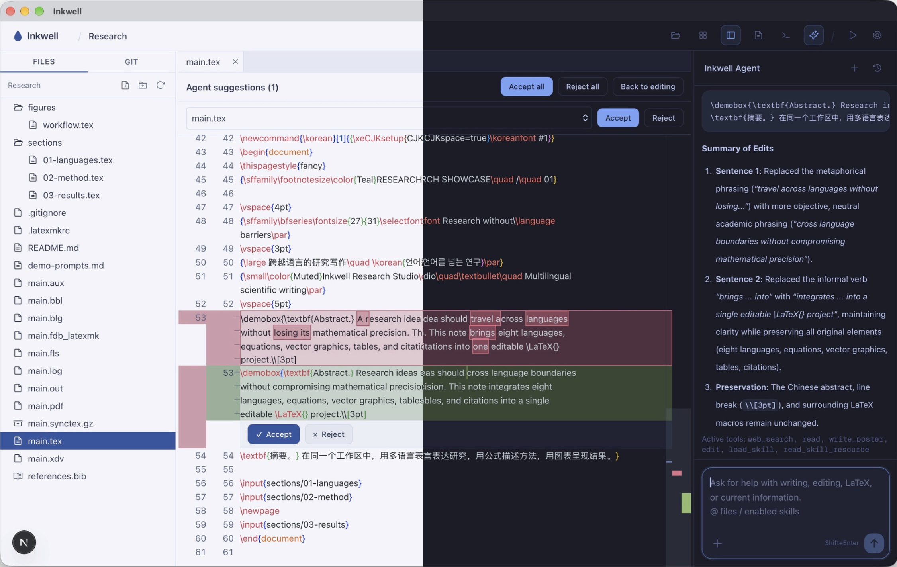
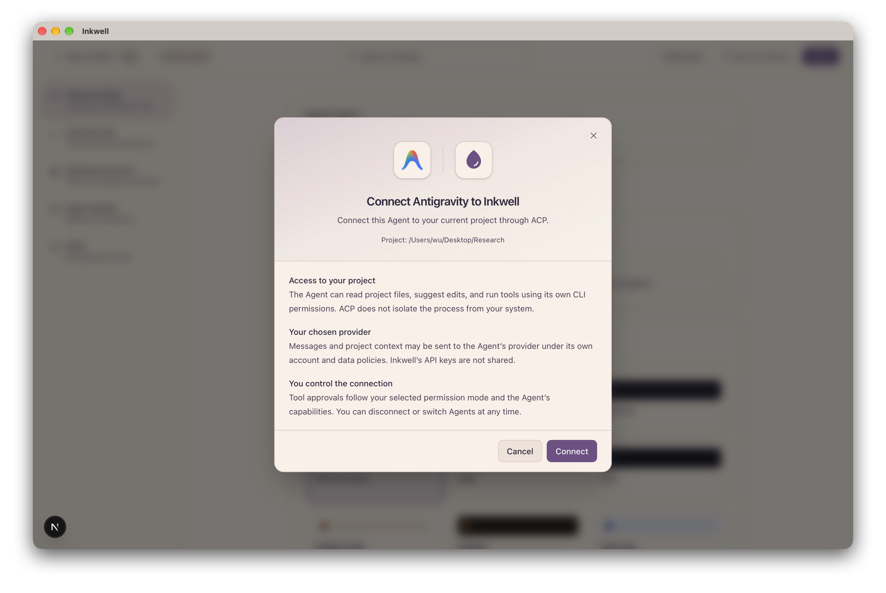

<div align="center">

# Inkwell

**A local-first LaTeX workspace for research writing.**

Inkwell brings paper editing, PDF preview, Agent collaboration, and Git version control into one desktop app. Keep your workflow connected, from the first draft through reviewing edits, compiling, and syncing your paper.

Your papers stay in ordinary local files. Continue using your existing tools and choose your own model provider or Agent.

[](https://github.com/Weifeng2Wu/inkwell/actions/workflows/desktop-build.yml)
[](LICENSE)
[](https://github.com/Weifeng2Wu/inkwell)

[Download](https://github.com/Weifeng2Wu/inkwell/releases/latest) · [Features](#core-features) · [Quick Start](#quick-start)

**English** | [简体中文](README_zh.md) | [한국어](README_ko.md)

</div>



## Core Features

### Automatic engine selection, less setup

Inkwell inspects your project source and installed compilers to select a suitable LaTeX engine. Compiler detection and installation helpers reduce manual setup.

View compilation results, inspect errors, and navigate between PDF and source with SyncTeX in the same workspace. Multilingual documents can use XeLaTeX or LuaLaTeX; required fonts and packages depend on the project.

### Version and sync your paper with Git

Inspect changed files, compare diffs, stage and commit edits, and sync with remote repositories through push and pull—all within the workspace.

Keep a revision history, continue on another device, or share a project with collaborators through Git. You can also publish projects to GitHub, including private repositories.

### Use the built-in Agent or connect a local Agent

Configure **Inkwell Agent** with an OpenAI-, Anthropic-, or Gemini-compatible API to discuss and revise your paper directly in the workspace.

You can also connect local Agents through **ACP (Agent Client Protocol)**, including Claude Code, Codex, OpenCode, and Antigravity, using their own accounts and configurations.

Before connecting, Inkwell explains project access and data use so you can decide whether to proceed.



### Review Agent edits in context

Agent suggestions appear as inline diffs: red marks the original text, and green marks the proposed replacement. Accept or reject individual changes, or handle the whole set together.

Keep suggestions, source, and PDF preview in the same workspace to check wording, equations, and layout.

### Add academic writing Skills to your Agent

Skills give your Agent reusable guidance for tasks such as paper organization, language polishing, submission formatting, and reviewer responses.

Import Skills from a folder, ZIP, Markdown file, or GitHub URL, and enable the ones your project needs. The built-in Agent and supported ACP Agents can share the guidance enabled for a project.

### Multiple themes and workspace layouts

Choose from multiple light and dark themes, with adjustable fonts, keyboard shortcuts, and split layouts.

Arrange source, PDF, Agent, and terminal panels to suit the task, whether you are focusing on writing or reviewing your paper alongside its preview.

## Quick Start

### 1. Download and install

Download the installer for your operating system from [GitHub Releases](https://github.com/Weifeng2Wu/inkwell/releases/latest).

**First launch on macOS**

Open the DMG and drag Inkwell into Applications.

The current version is not signed with an Apple Developer certificate or notarized, so macOS may report that the app is damaged. After confirming that you downloaded it from the official release, run these commands in Terminal:

```sh
sudo xattr -dr com.apple.quarantine "/Applications/Inkwell.app"
open "/Applications/Inkwell.app"
```

Enter your Mac login password when prompted. Terminal will not display characters as you type.

### 2. Open your paper project

Open an existing LaTeX project folder. Inkwell detects your compilation environment; if tools are missing, follow the installation prompts in the app.

### 3. Configure your Agent

Choose one option:

- **Built-in Agent:** enter your API endpoint, model, and API key.
- **Local Agent:** install the Agent and any required ACP adapter, select it in settings, and confirm the connection.

Import Skills as needed and enable academic writing guidance for your project.

### 4. Start writing

Edit your paper or ask the Agent for revisions, review and accept suggestions, then compile to preview the PDF. When you want to save or sync your progress, commit and push through Git.

---

[MIT License](LICENSE) · [Third-party notices](packages/academic-agent/THIRD_PARTY_NOTICES.md) · [Agent logo attribution](apps/desktop/public/agent-logos/LICENSE.txt)
