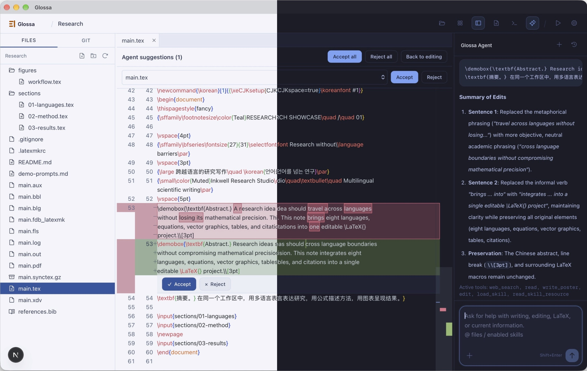
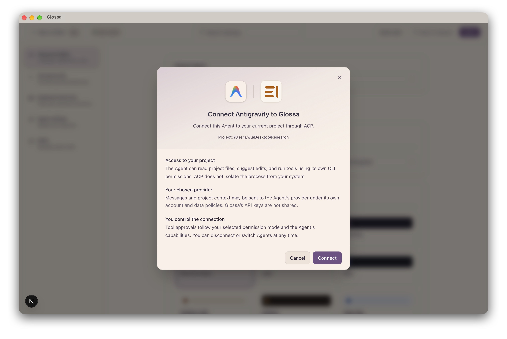

<div align="center">

# Inkwell

**연구 논문 작성을 위한 로컬 우선 LaTeX 워크스페이스.**

Inkwell은 논문 편집, PDF 미리보기, Agent 협업, Git 버전 관리를 하나의 데스크톱 앱에 모았습니다. 초안 작성부터 수정 검토, 컴파일, 동기화까지 논문 작성의 각 단계를 연결합니다.

논문은 로컬의 일반 파일로 보관됩니다. 기존 도구를 계속 사용하면서 모델 서비스와 Agent를 직접 선택할 수 있습니다.

[](https://github.com/Weifeng2Wu/inkwell/actions/workflows/desktop-build.yml)
[](LICENSE)
[](https://github.com/Weifeng2Wu/inkwell)

[다운로드](https://github.com/Weifeng2Wu/inkwell/releases/latest) · [핵심 기능](#핵심-기능) · [시작하기](#시작하기)

[English](README.md) | [简体中文](README_zh.md) | **한국어**

</div>



## 핵심 기능

### 컴파일 엔진 자동 선택으로 설정 간소화

프로젝트 소스와 설치된 컴파일러를 확인하여 적합한 LaTeX 엔진을 자동으로 선택합니다. 컴파일 환경 감지와 설치 지원으로 수동 설정을 줄입니다.

같은 워크스페이스에서 컴파일 결과와 오류를 확인하고 SyncTeX로 PDF와 소스 사이를 이동하세요. 다국어 문서는 XeLaTeX 또는 LuaLaTeX를 사용할 수 있으며, 필요한 글꼴과 패키지는 프로젝트에 따라 달라집니다.

### 논문 읽기와 문헌 관리

PDF를 가져오면 DOI, arXiv ID 또는 제목으로 논문을 식별하고 Crossref와 arXiv에서 메타데이터를 가져와 프로젝트의 `.bib` 파일에 기록합니다. DOI, 링크, 제목 또는 BibTeX 항목을 붙여 넣어 추가할 수도 있습니다.

읽는 동안 하이라이트, 밑줄, Markdown 노트, 선택 번역을 사용할 수 있고, 작성 중에는 문헌 목록에서 한 번의 클릭으로 인용을 삽입합니다. 문헌, PDF, 노트는 모두 프로젝트 안의 일반 파일이므로 Git으로 함께 동기화됩니다.

### 마인드맵, 드로잉과 학술 포스터

파일 트리의 오른쪽 클릭 메뉴나 명령 팔레트에서 마인드맵(`.mindmap.md`)과 Excalidraw 드로잉(`.excalidraw`)을 만듭니다. 단축키는 `Ctrl/Cmd+Alt+M`과 `Ctrl/Cmd+Alt+D`입니다. 프로젝트 파일로 저장하며 자동 저장, 분할 보기와 Git 동기화를 사용합니다.

마인드맵은 Markdown 제목과 중첩 목록으로 저장하며, 글꼴·색상·가지 방향은 인라인 메타데이터에 보관합니다. 좌우 가지, 노드와 하위 노드 스타일, 스페이스를 누른 채 드래그, 화면에 맞추기, 실행 취소 및 스타일을 유지하는 SVG 내보내기를 지원합니다. Tab은 하위 노드, Enter는 같은 단계 노드, F2는 이름 편집입니다. 드로잉은 공식 Excalidraw 형식과 앱에 포함된 글꼴을 사용합니다. 파일 트리와 탭은 마인드맵·포스터의 긴 확장자를 숨기고 전용 아이콘으로 구분하며, 마우스를 올리거나 이름을 바꿀 때 전체 이름을 표시합니다.

모든 `.poster.json` 파일은 자유 캔버스를 사용합니다. 직접 만들거나 Agent가 만든 포스터에서 글자·도형·그림을 이동하고 크기와 속성을 편집한 뒤 PPTX, SVG, PDF 또는 이미지로 내보냅니다. 새 문서와 Agent 제안은 version 1을 사용합니다. 기존 version 2 파일은 열 때 초기 배치를 계산하고 첫 캔버스 편집 시 version 1로 저장하며, 열기만 하면 파일을 바꾸지 않습니다. 이미지 생성은 선택 사항입니다.

마인드맵 노드를 두 번 클릭해 텍스트를 편집하고 옆의 더하기·빼기로 노드를 추가하거나 삭제합니다. 오른쪽 클릭으로 글꼴, 크기, 색상과 가지를 설정합니다. Ctrl/Cmd를 누르고 스크롤하면 포인터를 중심으로 확대·축소합니다.

### Git으로 논문 버전 관리와 동기화

워크스페이스에서 파일 변경과 차이를 확인하고, 스테이징과 커밋을 수행하며, push와 pull로 원격 저장소와 동기화합니다.

수정 이력을 남기고 다른 기기에서 작업을 이어 가거나 Git으로 공동 연구자와 프로젝트를 공유하세요. 비공개 저장소를 포함한 GitHub 프로젝트 게시도 지원합니다. 설정에서 자동 백업을 켜면 일정 간격으로, 그리고 앱을 닫을 때 변경사항을 커밋하므로 커밋을 잊어도 원고를 잃지 않습니다. 50 MB를 넘는 파일은 건너뜁니다.

### R2 / S3 프로젝트 백업

설정 → 동기화 및 백업에서 개인 Cloudflare R2 또는 S3 호환 버킷을 구성하며 GitHub와 함께 사용할 수 있습니다. 수동 스냅샷 또는 기본 30분 간격 자동 백업을 지원하고 변경되지 않은 내용은 재사용합니다. 기록에서 스냅샷을 골라 새 폴더에 복원합니다. 숨김 파일, 캐시, 앱 설정과 채팅 기록은 제외합니다. [설정 및 복원 안내](docs/CLOUD_BACKUP.md)를 참고하세요.

### 내장 Agent 사용 또는 로컬 Agent 연결

내장 **Inkwell Agent**에 OpenAI·Anthropic·Gemini 호환 API를 설정하면 논문 워크스페이스에서 바로 대화하고 수정을 요청할 수 있습니다.

**ACP(Agent Client Protocol)**를 통해 Claude Code, Codex, OpenCode, Antigravity 등의 로컬 Agent를 연결하고 해당 도구의 계정과 설정을 그대로 사용할 수도 있습니다.

연결 전에 프로젝트 접근과 데이터 사용에 대한 안내를 확인하고 연결 여부를 결정하세요.



### 원문에서 Agent 수정 검토

Agent의 수정 제안은 인라인 diff로 표시됩니다. 원문은 빨간색, 제안은 초록색으로 표시되며 변경 사항을 개별적으로 수락·거절하거나 한꺼번에 처리할 수 있습니다.

수정 제안, 소스, PDF 미리보기를 같은 워크스페이스에 두고 표현, 수식, 레이아웃을 확인하세요.

### Agent에 학술 작성 Skills 추가

Skills로 논문 구성, 문장 다듬기, 투고 서식, 심사 답변 등의 작업에 재사용할 수 있는 지침을 Agent에 제공합니다.

폴더, ZIP, Markdown 파일 또는 GitHub 링크에서 가져오고 프로젝트에 필요한 Skills만 활성화하세요. 내장 Agent와 지원되는 ACP Agent는 프로젝트에서 활성화한 지침을 공유할 수 있습니다.

### 다양한 테마와 워크스페이스 레이아웃

여러 밝은 테마와 어두운 테마를 제공하며 글꼴, 단축키, 분할 레이아웃을 조정할 수 있습니다.

작업에 맞게 소스, PDF, Agent, 터미널을 배치하고 집중 작성과 대조 검토 사이를 전환하세요.

## 시작하기

### 1. 다운로드 및 설치

[GitHub Releases](https://github.com/Weifeng2Wu/inkwell/releases/latest)에서 운영체제에 맞는 설치 파일을 다운로드하세요.

**macOS 첫 실행**

DMG를 열고 Inkwell을 응용 프로그램 폴더로 드래그하세요.

현재 버전은 Apple 개발자 인증서 서명과 공증이 없어 macOS에서 앱이 손상되었다는 메시지가 나타날 수 있습니다. 공식 Release에서 다운로드한 파일인지 확인한 뒤 터미널에서 실행하세요:

```sh
sudo xattr -dr com.apple.quarantine "/Applications/Inkwell.app"
open "/Applications/Inkwell.app"
```

요청 시 Mac 로그인 암호를 입력하세요. 입력하는 동안 터미널에는 문자가 표시되지 않습니다.

### 2. 논문 프로젝트 열기

기존 LaTeX 프로젝트 폴더를 여세요. Inkwell이 컴파일 환경을 감지하며, 필요한 도구가 없으면 앱의 안내에 따라 설치할 수 있습니다.

### 3. Agent 설정

다음 중 하나를 선택하세요:

- **내장 Agent:** API 주소, 모델, API 키를 입력합니다.
- **로컬 Agent:** 해당 Agent와 필요한 ACP 어댑터를 설치하고, 설정에서 선택한 뒤 연결을 확인합니다.

필요한 Skills를 가져와 현재 프로젝트에 학술 작성 지침을 활성화하세요.

### 4. 작성 시작

논문을 편집하거나 Agent에 수정을 요청하고, 제안을 검토·수락한 뒤 컴파일하여 PDF를 확인하세요. 진행 상황을 저장하거나 동기화하려면 Git으로 커밋하고 원격 저장소에 push하세요.

---

[MIT 라이선스](LICENSE) · [외부 구성 요소 고지](packages/academic-agent/THIRD_PARTY_NOTICES.md) · [Agent 로고 출처](apps/desktop/public/agent-logos/LICENSE.txt)
