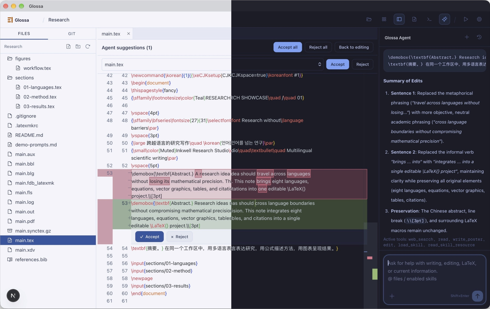
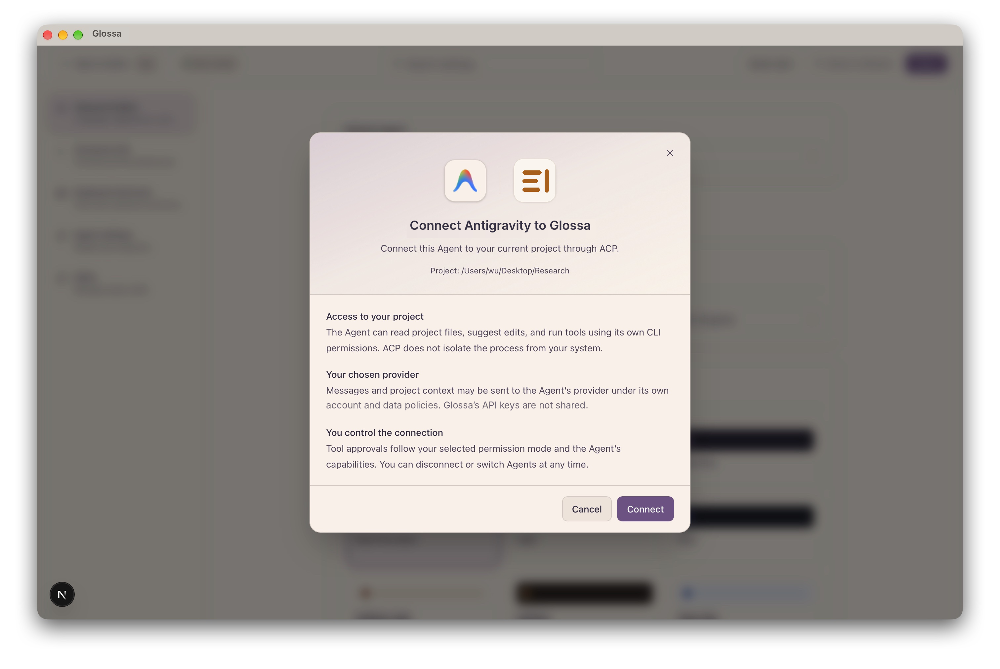

<div align="center">

# Inkwell

**为科研写作打造的本地优先 LaTeX 工作区。**

Inkwell 将论文编辑、PDF 预览、Agent 协作和 Git 版本管理放在同一个桌面应用中。从撰写初稿、审阅修改到编译与同步，让论文写作的各个环节保持连贯。

论文以普通文件保存在本地，你可以继续使用熟悉的工具，也可以选择自己的模型服务和 Agent。

[](https://github.com/Weifeng2Wu/inkwell/actions/workflows/desktop-build.yml)
[](LICENSE)
[](https://github.com/Weifeng2Wu/inkwell)

[下载安装](https://github.com/Weifeng2Wu/inkwell/releases/latest) · [核心功能](#核心功能) · [快速开始](#快速开始)

[English](README.md) | **简体中文** | [한국어](README_ko.md)

</div>



## 核心功能

### 自动选择编译引擎，减少环境配置

根据项目源码和已安装的编译器，自动选择合适的 LaTeX 引擎。提供编译环境检测与安装辅助，减少手动配置步骤。

在同一工作区查看编译结果、检查错误，并通过 SyncTeX 在 PDF 与源码之间跳转。多语言文档可使用 XeLaTeX 或 LuaLaTeX，所需字体与宏包由项目决定。

### 阅读论文并管理文献

项目任意目录中的 PDF 都会在后台自动识别，无需先打开文献库或手动导入。Inkwell 根据 DOI、arXiv 编号或标题从 Crossref 与 arXiv 获取元数据，在文件目录中显示论文标题，并将文献写入项目的 `.bib` 文件。悬停可查看作者、年份、刊物与原文件名，磁盘文件不会被重命名。也可以导入外部 PDF，或粘贴 DOI、链接、标题和 BibTeX 添加文献。

阅读时可高亮、下划线、写 Markdown 笔记和划词翻译；写作时在文献列表中一键插入引用。文献、PDF 与笔记都是项目内的普通文件，随 Git 一起同步。

### 思维导图、画板与学术海报

在文件树右键菜单或命令面板中新建思维导图（`.mindmap.md`）与 Excalidraw 画板（`.excalidraw`），也可使用 `Ctrl/Cmd+Alt+M` 和 `Ctrl/Cmd+Alt+D`。两者都保存为项目文件，并沿用自动保存、分栏和 Git 同步。

思维导图使用一个 Markdown 标题和嵌套无序列表存储，字体、颜色和分支方向保存在行内元数据中。支持左右分支、节点及子树样式、按住空格拖动画布、适应窗口、撤销重做和保留样式的 SVG 导出。选中节点后按 Tab 添加子节点、Enter 添加同级节点，F2 编辑文字。画板使用官方 Excalidraw 格式，字体随应用打包，可离线编辑。文件树和标签页收起导图、海报的长后缀，用不同图标区分；悬停和重命名时仍可查看完整文件名。

所有 `.poster.json` 统一使用自由画布，手动创建和 Agent 生成后的操作相同：移动、缩放文字与图形，通过属性栏编辑选中元素，再导出 PPTX、SVG、PDF 或图片。新建文档和 Agent 写入均使用 version 1。旧版 version 2 文件打开时计算初始布局，首次在画布中修改后保存为 version 1；仅打开不会改写文件。未配置图像生成服务也可创建海报。

双击导图节点直接改字，用节点旁的加减号增删节点，右键设置字体、字号、颜色或添加分支。按住 Ctrl/Cmd 滚动滚轮，以鼠标位置为中心缩放。

### 用 Git 管理论文与同步进度

直接在工作区查看文件修改、比较差异、暂存与提交，并通过推送和拉取同步远程仓库。

为论文保留修改历史，在不同设备间继续工作，也可以与合作者通过 Git 共享项目。支持将项目发布到 GitHub，包括私有仓库。在设置中开启自动备份后，Inkwell 会定时并在关闭应用时提交你的更改，不必惦记提交也不会丢稿；超过 50 MB 的文件会被跳过。

### 通过 R2 / S3 备份项目

在「设置 → 同步与备份」中配置自己的 Cloudflare R2 或兼容 S3 的存储桶，可与 GitHub 同时使用。手动保存项目快照，或启用默认每 30 分钟一次的自动备份，未变化的内容不重复上传。支持查看历史并恢复到新目录；隐藏文件、缓存、应用设置和聊天记录不在备份范围。详见[配置与恢复说明](docs/CLOUD_BACKUP.md)。

### 使用内置 Agent，或连接本地 Agent

为内置 **Inkwell Agent** 配置 OpenAI、Anthropic 或 Gemini 兼容接口，即可在论文工作区中开展对话与修改。

也可以通过 **ACP（Agent Client Protocol）** 连接本机的 Agent，例如 Claude Code、Codex、OpenCode 和 Antigravity，沿用对应工具的账户与配置。

连接前会展示项目访问和数据使用说明，由你确认是否连接。



### 在原文中审阅 Agent 修改

Agent 提出的修改以原位差异显示：红色标记原文，绿色标记建议内容。你可以逐处接受或拒绝，也可以统一处理整组建议。

修改建议、源码与 PDF 预览放在同一个工作区，便于检查措辞、公式和排版。

### 为 Agent 接入学术写作 Skills

通过 Skills 为 Agent 提供可复用的学术写作指导，涵盖论文组织、语言润色、投稿格式和审稿回复等任务。

支持从文件夹、ZIP、Markdown 文件或 GitHub 链接导入，并按项目启用需要的 Skills。内置 Agent 与受支持的 ACP Agent 可以共享项目启用的指导。

### 多套主题与工作区布局

提供多套浅色和深色主题，支持调整字体、快捷键与分栏布局。

根据当前任务安排源码、PDF、Agent 和终端的位置，在专注写作与对照审阅之间切换。

## 快速开始

### 1. 下载并安装

从 [GitHub Releases](https://github.com/Weifeng2Wu/inkwell/releases/latest) 下载适合你系统的安装包。

**macOS 首次运行**

打开 DMG，将 Inkwell 拖入“应用程序”。

当前版本尚未完成 Apple 开发者签名与公证，macOS 可能提示“应用已损坏”。确认安装包来自官方 Release 后，在终端执行：

```sh
sudo xattr -dr com.apple.quarantine "/Applications/Inkwell.app"
open "/Applications/Inkwell.app"
```

按提示输入 Mac 登录密码；输入时终端不会显示字符。

### 2. 打开论文项目

打开已有的 LaTeX 项目文件夹。Inkwell 会检测编译环境；如果缺少编译工具，可按应用内提示安装。

### 3. 配置 Agent

选择一种方式：

- **内置 Agent**：填写服务地址、模型和 API Key。
- **本地 Agent**：安装对应 Agent 及所需 ACP 适配器，在设置中选择它，并确认连接。

按需导入 Skills，为当前项目启用学术写作指导。

### 4. 开始写作

编辑论文或向 Agent 提出修改要求，检查并接受建议，然后编译查看 PDF。需要保存进度或同步时，通过 Git 提交并推送到远程仓库。

---

[MIT 许可证](LICENSE) · [第三方声明](packages/academic-agent/THIRD_PARTY_NOTICES.md) · [Agent 图标来源](apps/desktop/public/agent-logos/LICENSE.txt)
